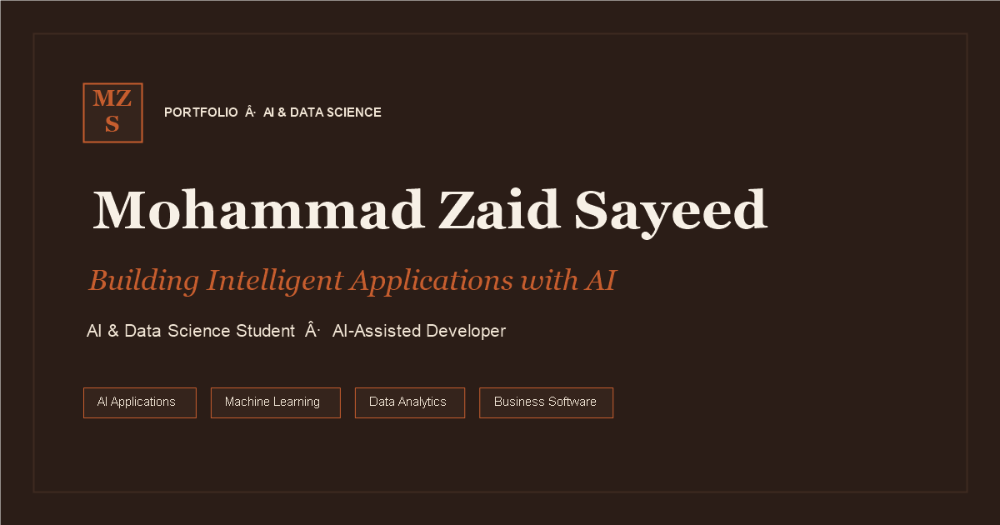

# Mohammad Zaid Sayeed — AI & Data Science Portfolio

> Personal portfolio website showcasing projects in AI, machine learning, data analytics, and business software.



---

## 🚀 Tech Stack

- **Framework**: [React 19](https://react.dev/) + [Vite](https://vitejs.dev/)
- **Styling**: [Tailwind CSS](https://tailwindcss.com/)
- **Smooth Scrolling**: [Lenis](https://lenis.darkroom.engineering/)
- **Animations**: [Framer Motion](https://www.framer.com/motion/)
- **Icons**: [Lucide React](https://lucide.dev/)
- **Deployment**: Vercel / Netlify

---

## ✨ Features

- **Editorial Espresso & Cream Aesthetic**: Tailored color palette with espresso (`#2B1D17`), cream (`#F7F0E6`), sand (`#EFE3D3`), and terracotta (`#C65D2E`).
- **Smooth Inertial Scrolling**: Lenis smooth scroll synchronized across anchor links and routes with `prefers-reduced-motion` compliance.
- **Dynamic Projects Gallery**: Categorized filtering (AI & Automation, Mobile & Business Apps, Data & ML, Websites, Concepts), detailed breakdown modals, and natural aspect-ratio screenshot lightbox.
- **Accessibility (WCAG AA)**: Skip-to-content links, ARIA labels, focus traps with Escape key restoration, and color contrast ratios $\ge 4.5:1$.
- **SEO & Social Optimization**: Open Graph cards, Twitter metadata, Person JSON-LD structured data, robots.txt, and sitemap.xml.
- **Responsive Layout**: Designed for mobile (360px+), tablet, and desktop viewports.

---

## 🛠️ Getting Started

### Prerequisites

- Node.js 18.x or higher
- npm 9.x or higher

### Installation

```bash
# Clone the repository
git clone https://github.com/zaidsayeed17/My_Portfolio_Website.git
cd My_Portfolio_Website

# Install dependencies
npm install

# Start development server
npm run dev
```

### Building for Production

```bash
# Build optimized production bundle
npm run build

# Preview production build locally
npm run preview
```

---

## 📦 Deployment

Refer to [`DEPLOY.md`](./DEPLOY.md) for step-by-step instructions on deploying to **Vercel** or **Netlify**.

---

## 📬 Contact

- **Website**: [zaidsayeed17.github.io](https://zaidsayeed17.github.io)
- **LinkedIn**: [Mohammad Zaid Sayeed](https://www.linkedin.com/in/mohammad-zaid-sayeed-9b42b42b7/)
- **GitHub**: [@zaidsayeed17](https://github.com/zaidsayeed17)
- **Email**: zaidsayeed17@gmail.com
